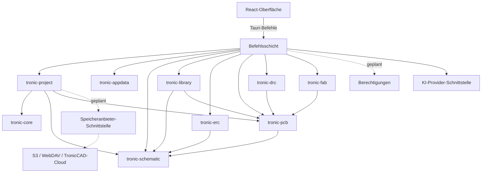

# Architektur

Dieses Dokument beschreibt Zielbild und Ist-Stand. **Vorhanden** sind nur die im Abschnitt „Module“ so markierten Teile.

## Leitlinien

1. **Der Kern kennt weder Oberfläche noch Speicherort.** Die CAD-Logik liegt in Rust-Crates ohne Abhängigkeit zu Tauri, Netzwerk oder konkreten Anbietern.
2. **Abhängigkeiten zeigen nach innen.** Adapter (Dateisystem, Cloud, KI-Anbieter, Simulator) hängen vom Kern ab, nie umgekehrt.
3. **Die Oberfläche hält keine Fachwahrheit.** Das Rust-Backend besitzt das Dokument, die UI sendet Befehle und zeigt den Zustand an.
4. **Text nur in der Oberfläche.** Das Backend liefert stabile Fehlercodes mit Parametern, übersetzt wird in der UI.
5. **Jede Funktion existiert einmal.** Editionen schalten Fähigkeiten frei, sie duplizieren keinen Code.

## Module

| Nr. | Modul | Umsetzung | Status |
|---|---|---|---|
| 1 | Desktop-Anwendung | `apps/desktop` | **Vorhanden (Grundfunktion)** |
| 2 | CAD-Kern | `tronic-core` | **Vorhanden (nur Projektmetadaten)** |
| 3 | Schaltplaneditor | `tronic-schematic`, `apps/desktop/src/schematic` | **Vorhanden** |
| 4 | PCB-Editor | `tronic-pcb`, `tronic-fab`, `tronic-router`, `apps/desktop/src/pcb` | **Vorhanden** |
| 5 | Bauteilbibliothek | `tronic-library` | **Vorhanden (Symbole, Footprints, einfache 3D-Körper)** |
| 6 | 3D-Engine | `tronic-3d`, `apps/desktop/src/view3d` | **Vorhanden** |
| 7 | Simulation | `tronic-sim`, `apps/desktop/src/simulation` | **Vorhanden (vereinfachte Modelle)** |
| 8 | KI-System | `tronic-ai`, `apps/desktop/src/ai` | **Vorhanden (ohne eigenes Modell)** |
| 9 | ERC | `tronic-erc` | **Vorhanden** |
| 10 | DRC | `tronic-drc` | **Vorhanden** |
| 11 | Projektverwaltung | `tronic-project`, `tronic-appdata` | **Vorhanden (lokal)** |
| 12 | Cloudsystem | `services/cloud`, `tronic-storage`, `apps/desktop/src/cloud` | **Vorhanden, kein laufender Dienst** |
| 13 | Teamverwaltung | `services/cloud`, `apps/desktop/src/team` | **Vorhanden** |
| 14 | Erweiterungen | `tronic-extensions`, `apps/desktop/src/extensions` | **Vorhanden**, [Anleitung](docs/EXTENSIONS.md) |
| 15 | Updateverwaltung | `tronic-update`, `apps/desktop/src/update` | **Vorhanden**, kein laufender Server, Installation nur Windows |
| 16 | Sicherheit und Qualität | `deny.toml`, `scripts/`, CI | **Vorhanden (Grundstufe)** |

## Schnittstellen

| Grenze | Art | Dokumentation |
|---|---|---|
| UI ↔ Backend | Tauri-Befehle, JSON | `apps/desktop/src/api/backend.ts` ist die einzige Stelle in der UI |
| Fehler | `{ code, params }` | `apps/desktop/src-tauri/src/error.rs`; ein Test prüft, dass jeder Code übersetzt ist |
| Projektdatei | Versioniertes Format | [docs/specs/project-file-format.md](docs/specs/project-file-format.md) |
| Crates | Öffentliche Rust-API | Rustdoc |

## Technologieentscheidungen

| Bereich | Entscheidung | Begründung |
|---|---|---|
| Kern | Rust | Vorgabe; Speichersicherheit, Leistung. `unsafe` ist im Workspace verboten, Ausnahmen brauchen eine Begründung |
| Desktop | Tauri 2.x (stabil) | Vorgabe. Tauri 3 ist auf crates.io nur Alpha und wird nicht eingesetzt |
| UI | React, TypeScript strict | Vorgabe |
| Übersetzung | i18next | Ausgereift, MIT, Plural- und Parameterunterstützung |
| Projektdatei | JSON mit Prüfsumme | Siehe unten |
| Lokale App-Daten | SQLite (rusqlite, gebündelt) | Vorgabe; nur Einstellungen und Listen |
| Cloud-DB | PostgreSQL über `tokio-postgres` | Vorgabe. `sqlx` kollidiert im Abhängigkeitsbaum mit dem SQLite der Desktop-App |
| Backend-Protokoll | REST und WebSockets mit axum, TLS am vorgeschalteten Proxy | Vorgabe |
| Zusammenarbeit | Bereiche und Sperren, Prüfung am Inhalt auf dem Server | Vorgabe H1: zunächst Bereiche und Sperren. Eine Echtzeit-Zusammenführung ist später möglich, ohne dieses Modell aufzugeben |
| Zertifikate | Zertifikatspeicher des Betriebssystems | Eigene Zertifizierungsstellen von Unternehmen funktionieren damit beim Selbsthosting |
| Synchronisierung | Unveränderliche Versionen wie bei Git, ohne Sperren | Funktioniert auf jedem Speicher, der Objekte hält, und kann nichts überschreiben |
| Schaltplan-Grafik | Canvas 2D | **Abweichung von wgpu**, begründet und gemessen in [ADR 0001](docs/adr/0001-schematic-rendering.md) |
| PCB-Grafik | Canvas 2D | Gemessen ausreichend, siehe [PERFORMANCE](reports/PERFORMANCE.md). **Abweichung von wgpu**, dasselbe ADR |
| 3D-Grafik | WebGL2, eigener Renderer | **Abweichung von wgpu**, begründet in [ADR 0002](docs/adr/0002-3d-rendering.md) |
| Flächenberechnung | `i_overlay` | Polygon-Booleans, MIT oder Apache-2.0, reine Rust-Bibliothek |
| Simulation | Eigene Engine in Rust | **Abweichung von ngspice**, keine Lizenzabhängigkeit, geringerer Umfang, [ADR 0002](docs/adr/0002-3d-rendering.md) |
| KI-Anbindung | HTTP mit `ureq`, Schlüssel mit `keyring` | Kein offizielles Rust-SDK, wenige Abhängigkeiten, beide Protokolle gleich behandelt |
| Lokale KI | Server des Benutzers, kein mitgeliefertes Modell | Modelllizenzen, Größe, freie Wahl. Abweichung von „Lokale Modelle“ im Produkt, siehe [Spezifikation](docs/specs/ai.md) |
| STEP | Nicht umgesetzt, OCCT nur als Kandidat in separatem Prozess | LGPL-Prüfung offen, Risiko R5 |

### Warum die Projektdatei kein SQLite ist

Die Vorgabe nennt SQLite für lokale Daten und zugleich Netzlaufwerke und NAS als Speicherorte. Die SQLite-Dokumentation warnt vor Datenbanken auf Netzwerkdateisystemen, weil dort das Sperren unzuverlässig sein kann. Deshalb gilt:

- **Projektdatei:** eine Datei, atomar per Umbenennen ersetzt, Konflikte per Inhalts-Hash erkannt. Das funktioniert auf lokalen Platten, externen Laufwerken und Netzlaufwerken gleich.
- **SQLite:** nur für lokale, wiederherstellbare Daten im Benutzerprofil.

Für große Leiterplatten wird das Format in Phase 3 auf Containerbasis überprüft, zum Beispiel mehrere Dateien in einem Archiv. Formatversion und Migration sind dafür vorgesehen.

## Speicher- und KI-Anbieter

Beide sind austauschbare Schnittstellen in eigenen Crates, der CAD-Kern kennt sie nicht. Umgesetzt sind `AiProvider` ([Spezifikation](docs/specs/ai.md)) und `StorageProvider` ([Spezifikation](docs/specs/cloud.md)). KI-Vorschläge sind Änderungsvorschläge aus einer geschlossenen Liste, die erst nach Vorschau und Freigabe laufen. ERC, DRC und Simulation sind von der KI getrennt und können von ihr nicht gesetzt werden.

## Git und CI/CD

- `main` ist immer lauffähig, Arbeit passiert auf `feature/*`, `fix/*`, zusammengeführt nach grüner CI. Siehe [CONTRIBUTING.md](CONTRIBUTING.md).
- CI-Definition: [.github/workflows/ci.yml](.github/workflows/ci.yml). Rust auf drei Betriebssystemen, UI-Tests, Sicherheit und Lizenzen, End-to-End unter Windows. **Noch nie ausgeführt**, weil kein Remote existiert.
- Release-Prozess: [docs/RELEASE.md](docs/RELEASE.md). Signaturschlüssel liegen außerhalb des Repositories.
